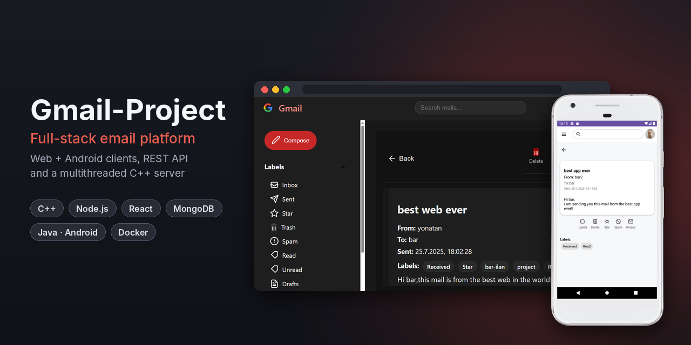
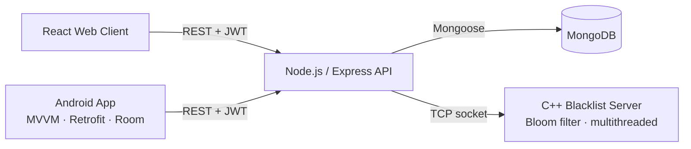
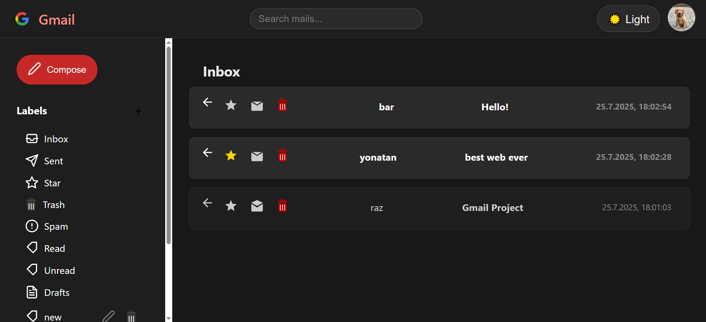
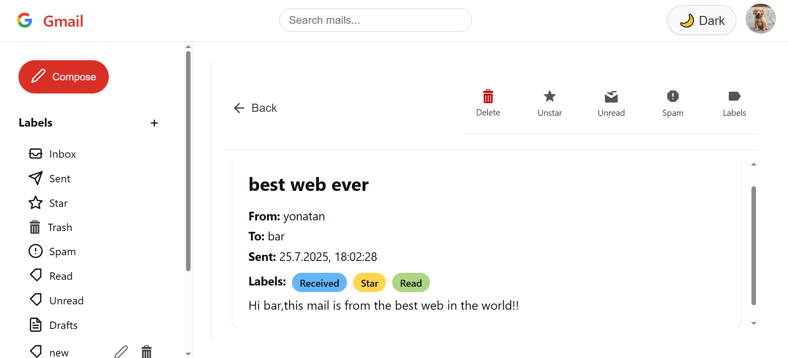
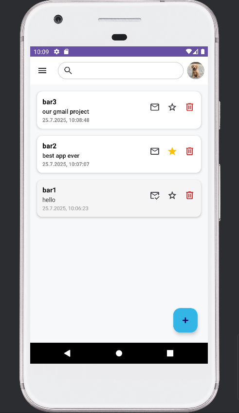
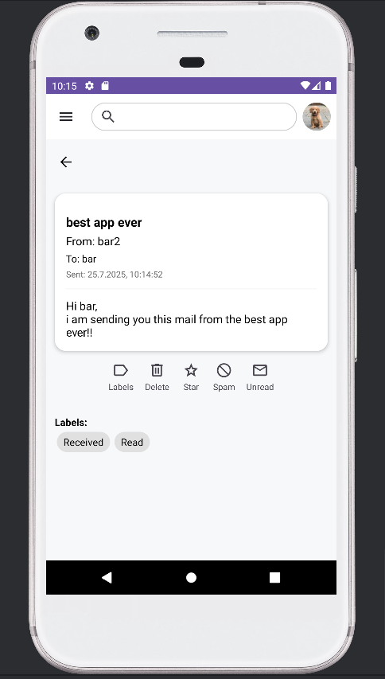
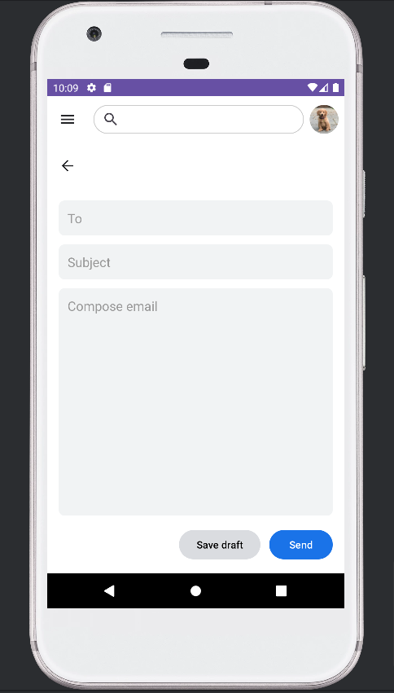

# Gmail-Project

A full-stack email platform inspired by Gmail – with a web client, a native Android app, a Node.js REST API and a multithreaded C++ security server.

Send, organize and search mail across web and mobile, while every link is checked against a Bloom-filter blacklist before delivery.



---

## Table of Contents

- [Overview](#overview)
- [Features](#features)
- [Architecture](#architecture)
- [Tech Stack](#tech-stack)
- [Screenshots](#screenshots)
- [Project Structure](#project-structure)
- [Quick Start](#quick-start)

---

## Overview

This project was developed as part of the Advanced Programming Systems course by a team of three computer science students, following the Agile Scrum methodology.

The system is built from four main components:

1. **C++ TCP server** – maintains a Bloom-filter-based URL blacklist. Handles multiple clients concurrently over TCP sockets and persists its data to a file.
2. **Node.js API server** – a RESTful API for authentication, mail operations, labels and spam handling. Built with an MVC structure and SOLID principles, using MongoDB for storage.
3. **React web client** – a responsive, Gmail-style web interface.
4. **Android app** – a native mobile client (MVVM, Retrofit, Room) that connects to the same backend and mirrors the web app's functionality.

For detailed walkthroughs of every screen, see the project [wiki](wiki/).

---

## Features

- User registration, login and profile management
- Composing, sending and saving drafts
- Inbox, Sent, Drafts, Spam and Trash folders
- Creating, editing and assigning labels
- Searching and filtering mail
- Automatic spam detection – links are checked against the C++ Bloom-filter blacklist
- Marking a mail as spam adds its links to the blacklist; un-marking removes them
- Soft and permanent deletion
- Light and dark mode (web)

---

## Architecture



- Both clients talk only to the API server, authenticated with JWT.
- The API server stores users, mails and labels in MongoDB.
- Before a mail is delivered, the API server asks the C++ server whether any of its links are blacklisted; mails with blacklisted links are moved to Spam.
- All backend services run in Docker containers, orchestrated with Docker Compose.

---

## Tech Stack

| Layer | Technologies |
|---|---|
| Security service | C++, POSIX sockets, multithreading, Bloom filter, CMake |
| Backend API | Node.js, Express, MongoDB (Mongoose), JWT |
| Web client | React |
| Mobile client | Java, Android (MVVM, Retrofit, Room) |
| Infrastructure | Docker, Docker Compose |

---

## Screenshots

| Web – Inbox (dark mode) | Web – Mail view |
|---|---|
|  |  |

| Android – Inbox | Android – Mail view | Android – Compose |
|---|---|---|
|  |  |  |

More screens: [Web walkthrough](wiki/web.md) · [Android walkthrough](wiki/android.md)

---

## Project Structure

```
Gmail-Project/
├── backend/             # C++ TCP server (Bloom-filter blacklist)
├── api/                 # Node.js + Express API server
├── frontend/            # React web client
├── android/             # Android Studio project
├── wiki/                # Documentation and screenshots
└── docker-compose.yml   # Orchestrates all services
```

---

## Quick Start

```bash
git clone https://github.com/bar-nakdimon/Gmail-Project.git
cd Gmail-Project
# create config/.env.local – see the Setup Guide
docker compose --env-file ./config/.env.local up --build
```

Then open [http://localhost:3001](http://localhost:3001).

Full setup instructions, including environment variables and the Android app: **[Setup Guide](wiki/setup.md)**
